## 前言

2026 年下半年，常去超市和菜市场的人都有一个直观的感受：**便宜了两三年的牛肉，又贵回来了。**

据农业农村部监测，自 2026 年第 27 周（6 月 29 日—7 月 5 日）起，全国牛肉批发市场周均价连续 15 周以上环比上涨，10 月中旬周均价已达 73.4 元/公斤，同比上涨 11% 以上，创近两年新高。[澎湃新闻](https://www.thepaper.cn/newsDetail_forward_34324515)[光明网](https://life.gmw.cn/2026-10/31/content_39078832.htm) 零售端的感受更直接：3 月至国庆节前，全国集市牛肉价格涨幅超过 16%；发改委 36 个大中城市鲜牛肉（腱子肉）零售均价 2026 年 9 月达 43.78 元/500 克。[饲料市场](http://www.chinafeedm.com/h-nd-32657.html)[CEIC](https://www.ceicdata.com/zh-hans/china/price-monitoring-center-ndrc-36-city-monthly-avg-retail-price-food/cn-retail-price-36-city-avg-fresh-beef-tendon-shank)

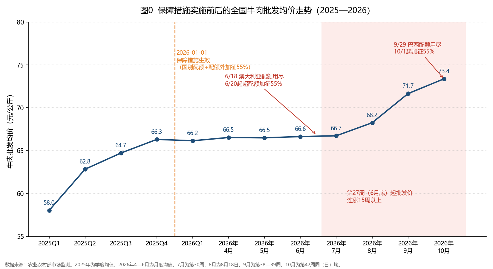

需要说明：图中 2025 年的上涨发生在关税生效之前，主要是周期修复——2023—2024 年养殖深度亏损导致母牛被大量清栏，经 27—28 个月繁育周期兑现为出栏收缩，叠加国际牛价上行；而 2026 年 6 月底之后的陡升，才是澳、巴相继用尽配额、配额外 55% 关税实质生效的直接结果。当前的高价，是"产能出清"与"贸易措施"两股力量同向叠加的产物。

本文试图回答一个朴素的问题：**当政策在"保护国内产业"与"消费者的餐桌"之间做出取舍时，普通民众是什么态度？这场取舍又是如何被做出的？**

全文分四个部分：第一部分**牛肉关税的基本介绍**交代事实基础——从立案与裁定的时间线、进口五年翻倍的量价数据、26—38 元/公斤的价格剪刀差，到国内产业"重大、全面、持续加剧"的减损证据，再到保障措施的具体设计（国别配额 + 55% 配额外关税）。第二部分**各方的利益对抗**复盘这场 81 个利害关系方卷入的公开博弈，还原 7 大争点的攻防裁决与五大利益阵营的输赢分化。第三部分**普通民众的态度**基于知乎 709 条可获取回答的统计，呈现"想吃便宜牛肉的消费者"与"保护产业的支持者"之间的舆论对峙。第四部分是笔者的三点个人观点。

## 牛肉关税的基本介绍

### 时间线介绍

2024 年 11 月 22 日，中国畜牧业协会等 **10 家行业协会**代表国内牛肉产业，通过北京市博恒律师事务所向商务部提交《牛肉保障措施调查申请书》。2024 年 12 月 27 日，商务部发布 **2024 年第 60 号公告**立案调查，调查期为 2019 年 1 月 1 日至 2024 年 6 月 30 日。历时一年调查（两次延期），2025 年 12 月 31 日商务部发布 **2025 年第 87 号公告**：裁定进口牛肉数量增加与国内产业严重损害之间存在因果关系，决定采取保障措施，自 **2026 年 1 月 1 日**起实施。

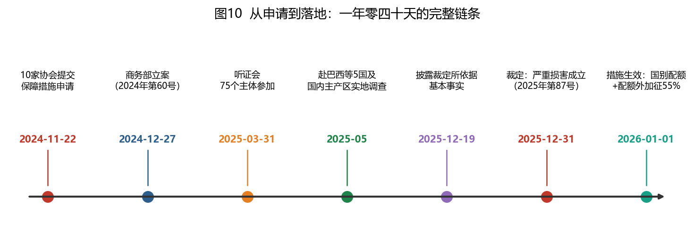

### 为什么要查：进口牛肉五年翻了近一倍

调查期内，中国牛肉进口持续攀升：

- **绝对量**：进口量从 2019 年的 165.94 万吨增至 2023 年的 273.69 万吨（+64.93%）；2024 年上半年达 143.86 万吨，同比增长 17.02%。2019–2023 年年均进口 231 万吨，是 2014–2018 年年均值的**近 4 倍**，且 2020 年后每年都在创造历史最高进口纪录。

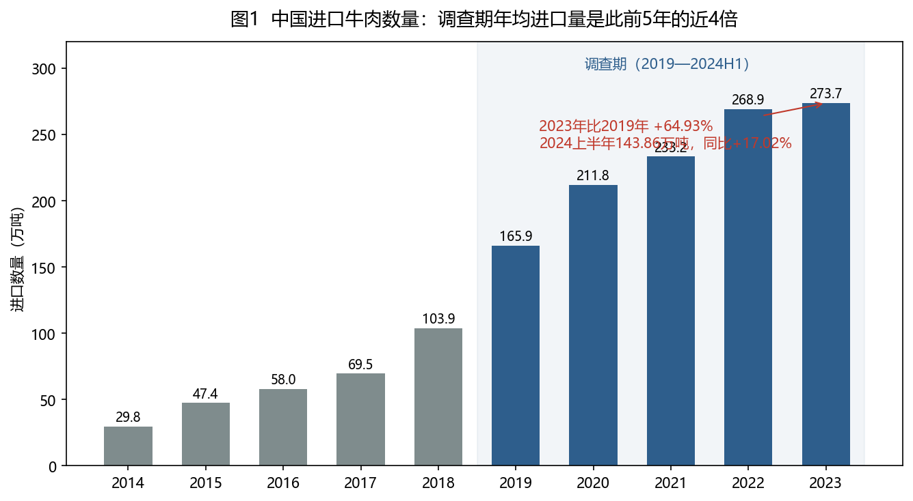

- **相对量**：进口牛肉占国内市场份额由 2019 年的 20.55% 升至 2024 上半年的 30.90%（+10.35 个百分点）；进口量相当于国产牛肉产量的比例从 24.87% 升至 **43.86%**。进口增量占国内需求增量的比重多数年份在 40% 以上，2022 年甚至达到 104.51%——市场需求增长的增量部分几乎全部被进口占据。

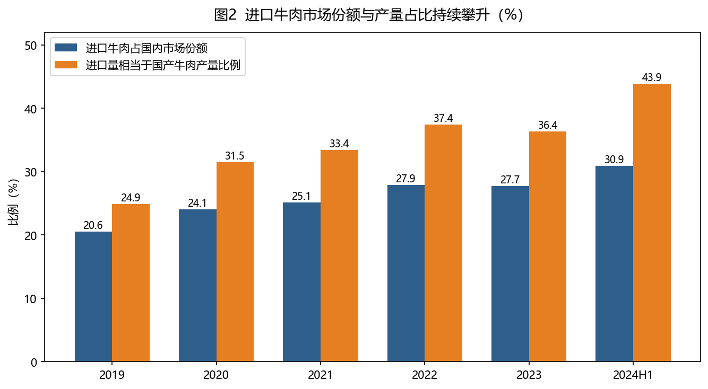

### 为什么进口牛肉势不可挡：价格剪刀差

进口牛肉在中国市场获得压倒性优势的直接原因是**巨大的价格差**。经对海关 CIF 价格按汇率、关税和清关费用调整后，调查期内进口牛肉价格始终比国产牛肉低 **26—38 元/公斤**，价差最大时进口价格仅为国产的约 55%。叠加 2023、2024 年进口价格连续大幅下滑（CIF 价分别 -21.3%、-11.2%），低价优势持续放大。

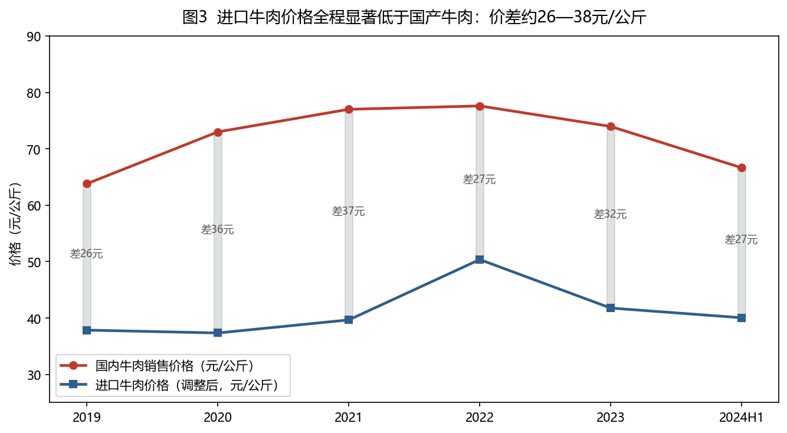

价格的背后是两大"未被预见的发展"（这是保障措施合法性的关键要件）：

1. **出口国出口能力暴增**：2001→2024 年，巴西牛肉出口能力增长 **309%**、阿根廷增长 **629%**（巴西产量 +63% 而出口能力 +309%；阿根廷产量仅 +19%，因国内需求下降，出口能力 +629%）；
2. **货币长期大幅贬值**：2024 上半年比 2001 年，巴西雷亚尔贬值 122%、乌拉圭比索贬值 196%、**阿根廷比索贬值 61 942%**。再加上 2018 年非洲猪瘟导致猪肉减产 21.3%、消费者转投牛肉，三个因素叠加拉动进口激增——这些在中国 2001 年加入 WTO 时均无法预见。

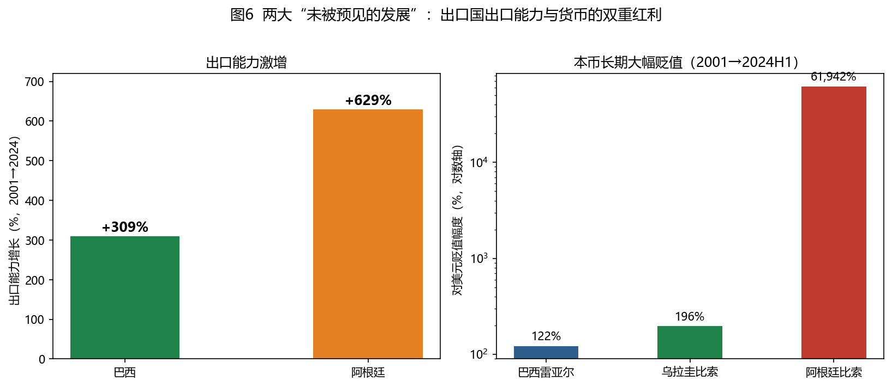

### 产业受损有多严重：从"先盈后亏"到全面减损

裁定书用 15 项指标刻画了国内产业"重大、全面、持续加剧"的减损：

- **肉牛养殖端（最惨）**：利润总额 2021 年见顶（820 亿元）后急转直下，2023 年由盈转亏（**-140.89 亿元**），2024 上半年亏损扩大至 **-183.73 亿元**（同比多亏 298.96%），税前利润率从 +15.31% 跌至 **-11.74%**；能繁母牛被大量屠宰止损，2024 上半年存栏同比减少 143 万头，产业基础产能遭到破坏；
- **牛肉屠宰加工端**：期末库存连年激增（2023 年 +33.94%、2024H1 再 +33.73%），销售收入和利润 2023 年由增转降，2024H1 利润总额同比暴跌 **83.80%**，利润率仅 1.05%，处于亏损边缘；
- **2024 年上半年全面恶化**：牛肉价格 -12.78%、收入 -9.52%；活牛价格 -18.79%、收入 -16.85%。在需求增长 7.51% 的年份，国内产业反而全面失血——这正是"低价进口挤压"的典型图景。

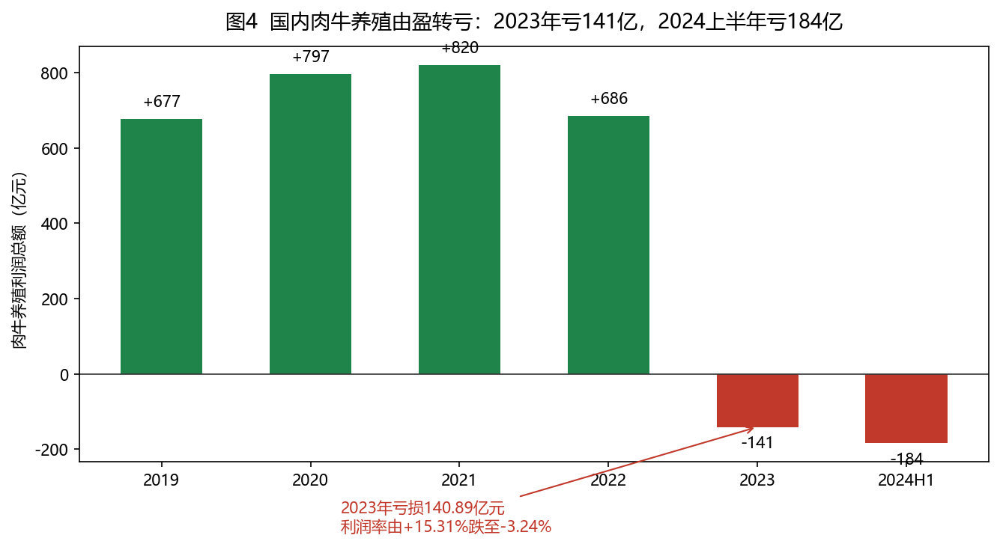

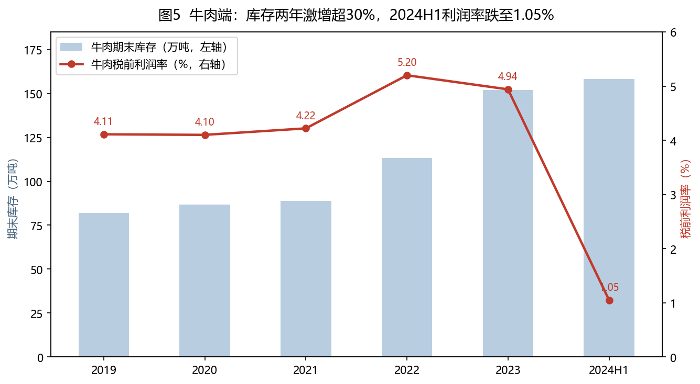

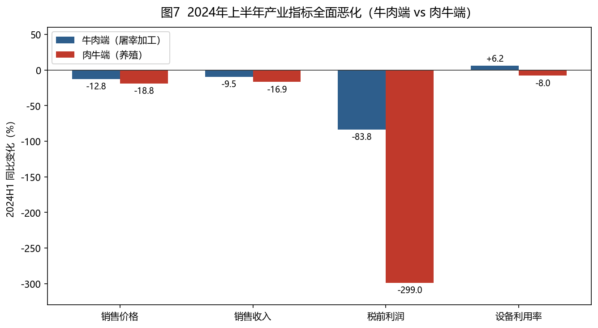

### 措施本身：国别配额 + 配额外加征 55% 关税

措施采取"**国别配额及配额外加征关税**"形式，实施期 3 年（2026-01-01 至 2028-12-31），并逐年小幅放宽：

| 国家/地区      | 第一年（2026） | 第二年（2027） | 第三年（2028） |
| -------------- | -------------- | -------------- | -------------- |
| 巴西           | 110.6 万吨     | 112.8 万吨     | 115.1 万吨     |
| 阿根廷         | 51.1 万吨      | 52.1 万吨      | 53.2 万吨      |
| 乌拉圭         | 32.4 万吨      | 33.1 万吨      | 33.7 万吨      |
| 新西兰         | 20.6 万吨      | 21.0 万吨      | 21.4 万吨      |
| 澳大利亚       | 20.5 万吨      | 20.9 万吨      | 21.3 万吨      |
| 美国           | 16.4 万吨      | 16.8 万吨      | 17.1 万吨      |
| 其他国家和地区 | 17.2 万吨      | 17.5 万吨      | 17.9 万吨      |
| **合计**       | **268.8 万吨** | **274.2 万吨** | **279.7 万吨** |

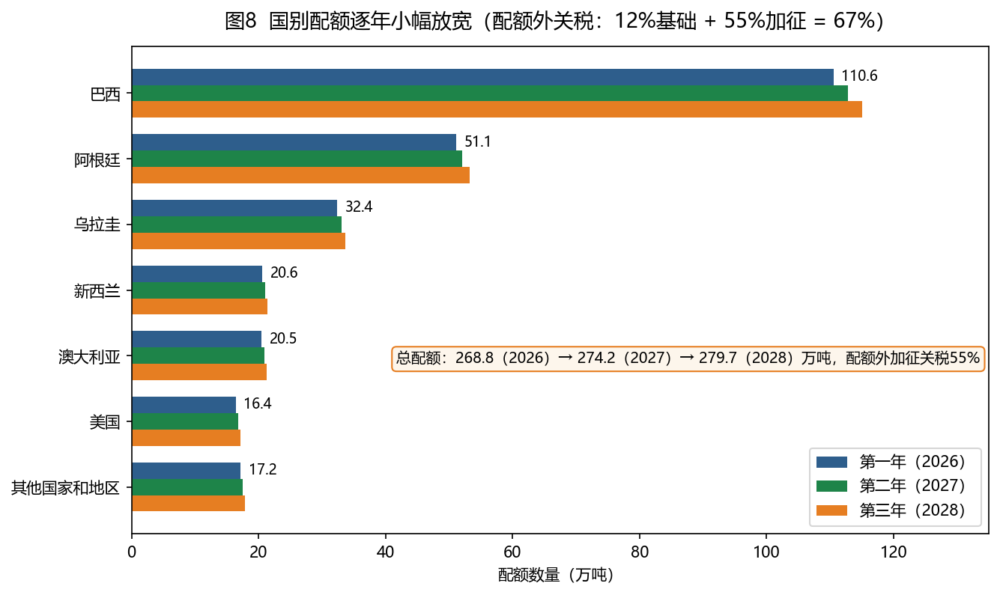

执行规则要点：

1. **配额内**：按现行 12% 关税正常进口；上一年度未用完的配额**不结转至下一年**；
2. **配额外**：自达到规定数量第 3 日起，在现行关税基础上**加征 55%**（综合税负约 67%）；
3. **微量豁免**：对进口份额不超过 3%（合计不超过 9%）的发展中国家（地区）不适用——豁免名单涵盖 140 余个经济体，但均为对华出口量极小的国家；
4. **澳新特殊安排**：《中澳自贸协定》下的牛肉特殊保障措施**暂停实施**；另外按自贸协定通报并磋商机制与新西兰等沟通；
5. **复审条款**：实施期间商务部可依情势变化依法审查措施的形式和水平 [商务部公告2025年第87号](https://www.mofcom.gov.cn/zwgk/zcfb/art/2025/art_d6a23dcbc58642d880a21b4cd6aafb91.html)。

## 各方的利益对抗

### 谁在场：81 个主体卷入的公开博弈

立案后共有 21 个国外政府和机构、11 个国外商协会、8 个国外出口商/生产商、17 个国内进口商、9 个国内生产者、4 个国内下游用户等 **81 个主体**登记参加调查；其中 75 个主体派代表出席 2025 年 3 月 31 日听证会，37 家在会上发言，听证会后 35 家提交了书面意见。

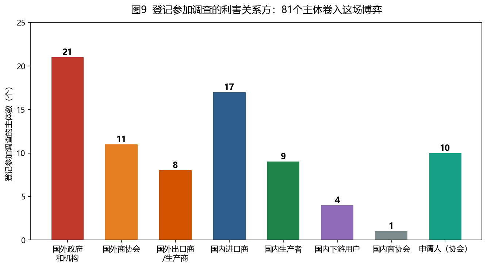

各方可归为 **5 大利益阵营**：

| 阵营                   | 代表                                                        | 核心利益                           |
| ---------------------- | ----------------------------------------------------------- | ---------------------------------- |
| 国内牛肉产业（申请方） | 10 家协会、中国肉类协会、国内生产者                         | 限制进口、恢复利润与产能           |
| 出口国政府与海外出口商 | 巴西、阿根廷、澳大利亚等 21 国政府，11 家商协会，8 家出口商 | 保住对华出口空间                   |
| 国内进口商与下游用户   | 17 家进口商（含山姆、中粮系），金拱门、紫燕、王品等         | 保住低价货源、供应链稳定           |
| 消费者                 | 无直接程序参与                                              | 终端价格与选择空间                 |
| 裁量方                 | 商务部贸易救济局 + 国务院关税税则委员会                     | 产业保护、贸易关系、物价稳定的平衡 |

### 七大争点的攻防全景

出口方（含部分进口商、下游）围绕 7 个争点发起进攻，申请人及中国肉类协会防守，商务部逐条裁决：

**争点 1：产品范围** — 进攻方要求将冷鲜牛肉、带骨牛肉、美国农业部分级认证牛肉排除出调查范围（"量小、价高、不同质"）。**裁决：全部不接受**——是否对华出口及数量多少不是排除标准，且未证明与国内产品无竞争关系。

**争点 2：进口是否"近期、突发、急剧、显著"增加** — 进攻方称增长集中在调查期初期、后期放缓，2024H1 比 2023H2 下降。裁决：下半年是旺季不能跨年比；半年/全年/单月口径都显著增长，年均进口近 4 倍于前五年——成立。

**争点 3：是否存在"未被预见的发展"** — 进攻方称增长源于居民收入提高和自贸协定主动开放，货币波动"90 年代就有"。裁决：收入提高"不必然指向牛肉，更不必然指向进口牛肉"；反例：2023 年巴西获对华资质工厂 +10%，实际对华出口反而 **-3%**，准入≠激增——三项不可预见因素成立。

**争点 4：同类产品与直接竞争产品** — 进攻方称进口牛肉品质更优不构成竞争，肉牛只是上游不算直接竞争产品。裁决：用途、工艺、渠道基本相同；"肉牛是行走的牛肉"，客户直接在肉牛与进口牛肉间比价——**国内产业 = 牛肉生产者 + 肉牛养殖者全体**，这决定了保护圈覆盖上游养殖。

**争点 5：是否构成"严重损害"** — 进攻方称产量、销量、价格、收入都在增长。裁决：增幅收窄直至由增转跌；产量增长是亏损后清栏抛售的假象，能繁母牛 2023 年减少 143 万头反而说明基础产能受损——认定"重大全面减损"。

**争点 6：因果关系** — 进攻方称进口增幅最小的年份恰是指标恶化之年，时间对不上。裁决：农业市场传导有滞后，损害是积蓄显现的；并**逐一批驳 8 个替代原因**：

| 替代原因主张     | 裁决依据                                             |
| ---------------- | ---------------------------------------------------- |
| 猪肉降价挤压     | 牛肉与猪肉价格走势不一致（2020–22 猪价跌、牛价涨）   |
| 产业自身分散低效 | 劣势调查期前已存在且未恶化；改进措施下本应改善却恶化 |
| 消费需求萎缩     | 需求 2023 年比 2019 年 +22.34%，与事实相反           |
| 淘汰奶牛冲击市场 | 非正常淘汰奶牛牛肉仅占总产量 0.3%                    |
| 高价期盲目投资   | 无可核实证据、不具代表性                             |
| 成本大幅上升     | 2024H1 成本降 5–8% 而利润再降 84–299%，成本论不成立  |
| 走私牛肉冲击     | 无量化证据                                           |
| 国际牛周期       | 周期变化与指标实际变动不一致                         |

**争点 7：公共利益** — 下游（金拱门、紫燕、中粮万威客等）担心措施推高价格、断供、影响粮食安全。裁决：不采取措施产业将进一步恶化，基础产能减损将反过来冲击市场供应稳定。值得注意的是裁定脚注：2025 年 1–6 月进口下降、产业有所缓解，但 **7–10 月进口量同比暴增 22.4%**、价格再度承压——这基本堵死了"产业正在自愈"的退路。

### 博弈结果：谁赢、谁输、谁分化

- **产业方完胜**：7 个争点的论点几乎全部获得支持，申请书的核心论证框架（尤其"未被预见的发展"和价格逆转分析）被裁定书整体沿用；
- **出口方受损最大**：配额直接封顶主要出口国的对华出口量，配额外 55% 的加征税率基本切断超量进口的商业可行性；
- **下游与进口商部分实现目标**：措施没有采取更严厉的数量限制，而是"配额+关税"且逐年放宽、对 140 余个微小来源国豁免、暂停对澳自贸特保——这些折中设计明显回应了下游对供应稳定的关切；
- **消费者**：**没有出现在程序中，却将在未来三年为价格上涨承担成本——这正是下文民意的核心分歧**。

## 普通民众的态度

这里选取知乎上一个相关问题的回答进行统计，查看民众对于牛肉关税的态度。

数据来源：[知乎问题《商务部公告，自巴西进口牛肉 10 月 1 日零点起加征 55% 关税，哪些信息值得关注？](https://www.zhihu.com/question/2088566222321406687)

抓取时间：2026-11-07 。

抓取的回答数量：知乎页面显示 1,448 个回答，只能抓取到 709 条完整回答。剩余约 739 条，平台不提供任何访问通道，属平台限制而非采集遗漏。以下分析基于可获取的全部 709 条。

### 回答总体画像

| 指标       | 数值                                                                     |
| ---------- | ------------------------------------------------------------------------ |
| 发布时段   | 2026-09-30 ~ 11-06，峰值 10-02（295 条，占 41.6%），10-03 次之（139 条） |
| 赞数分布   | 中位数 2 赞；0 赞 203 条；≥100 赞 53 条；≥1000 赞 12 条                  |
| 赞数集中度 | Top 10 回答占 65.3%，Top 50 占 89.6%，Top 100 占 95.0%                   |
| 篇幅       | 中位数约 40 字；不足 100 字占 68.5%；≥500 字 66 条                       |
| 含实拍图   | 53 条（7.5%，多为超市价签、牛羊肉补贴通知、海外肉价对比）                |

整体呈「少数高赞回答定调 + 大量短评跟风玩梗」的结构：10 月 1 日关税生效当天引爆，次日达到峰值，一周内热度基本消退。

### 立场分布

| 立场                          | 回答数 | 占比  | 获赞   | 赞占比 |
| ----------------------------- | ------ | ----- | ------ | ------ |
| 明确支持加税 / 保护产业       | 139    | 19.6% | 11,506 | 20.6%  |
| 明确反对加税 / 支持放开进口   | 103    | 14.5% | 16,611 | 29.7%  |
| 阴阳怪气 / 科普 / 玩梗 / 跑题 | 467    | 65.9% | 27,838 | 49.8%  |

两点判断：其一，按获赞数，**反对声音明显占优**——最高赞回答（11,999 赞，占全部赞数 21%）即「让老百姓吃便宜安心牛肉」的放开派；其二，65.9% 的「其他」回答经抽查以嘲讽加税、双标讽刺、想吃便宜牛肉的**隐性反对**居多，但纯玩梗与真中立（程序科普、价格数据）也占相当比例，边界模糊。整体是「消费者情绪 vs 产业逻辑」的对峙。

### 主要观点阵营

#### 反对派：想吃便宜牛肉的消费者阵营

1. **「牛肉自由」（核心理论：资源禀赋论）**。中国没有好草场、饲料贵（玉米比国际贵近八成、豆粕依赖进口大豆）、肉料比约 7:1、母牛一胎一犊两年一胎、九成散户——养牛在物理和会计上不成立；牛肉不是战略物资，不涉粮食/蛋白安全；年贸易顺差 1.19 万亿美元，牛肉进口仅 150 亿美元，「赚顺差就是为了买」。
2. **双标合订本**。中国工业品冲垮别人产业时讲自由贸易，轮到自己劣势产业就配额加税；

#### 支持派：保护产业阵营

1. **程序合法**。2024-12-27 应国内产业申请立案 → 2025-12-31 裁定严重损害 → 2026-1-1 实施国别配额（总 268.8 万吨：巴西 110.6、阿根廷 51.1、乌拉圭 32.4、新西兰 20.6、澳大利亚 20.5、美国 16.4），配额外 12%+55%=67%；WTO《保障措施协定》允许，为期三年，且澳大利亚 6 月 18 日就率先撞线，并非针对巴西。
2. **散户生计（最有感染力的长文）**。全国约 750 万养殖场户、90% 为年出栏 10 头以下散户；冲击下活牛价跌近三成、一头亏 1600~2000 元、能繁母牛被清栏（补回需 3~4 年）；西南、西北、东北脱贫县面临返贫风险；「农村是危机软着陆的港湾」。
3. **国际惯例**。日本大米配额外关税超 700%、韩牛保护、欧美农业补贴、中国小麦玉米配额外 65% 已实行几十年——「在自己占优势的领域喊自由、劣势领域设保护，全世界无一例外；自由贸易是强者的台词。」
4. **安全底线**。全部依赖进口会被断供、被联合涨价卡脖子，「不能重蹈大豆覆辙」。
5. **双标反问**。「你买牛肉的钱就是养牛人的工资」「汽车行业保护这么多年、巨额补贴，怎么没人跳出来说出清落后产能」。

### 一句话总结

普通民众的态度高度分裂且以情绪表达为主：**作为消费者的多数派想要便宜牛肉、反感为产业保护买单**（按赞数占上风，表达方式以反讽玩梗为主）；**支持派以养殖户生计、程序合规和国际惯例为据，长文质量更高但声量稍弱**；其间还活跃着借题发挥的民族情绪支线与大量时政联想（巴西大选、中美贸易战、双标合订本）。**值得注意的是，正反双方都承认国产牛肉成本劣势是资源禀赋决定的，真正的分歧在于——「不值当养的产业，该不该由消费者掏钱保住」**。

## 最后：我的观点

1. 我个人倾向于，加关税，保护国内的牛肉产业。因为这在一定程度上，保护了落后产业，让更多人有工作，降低社会的失业率，维护社会稳定。(但牛肉关税具有累退性：税负落在每个买肉的人头上，对低收入家庭占比更高)
2. 但是，我反对，一直保护。国内还是应该规模化养殖，提高提高效率，将自给率控制在一定水平即可。
3. 最反对的是，整个政策的制定过程中，“消费者”这个角色，不在谈判桌上。“不值当养的产业，该不该由消费者掏钱保住” 没有被讨论。
